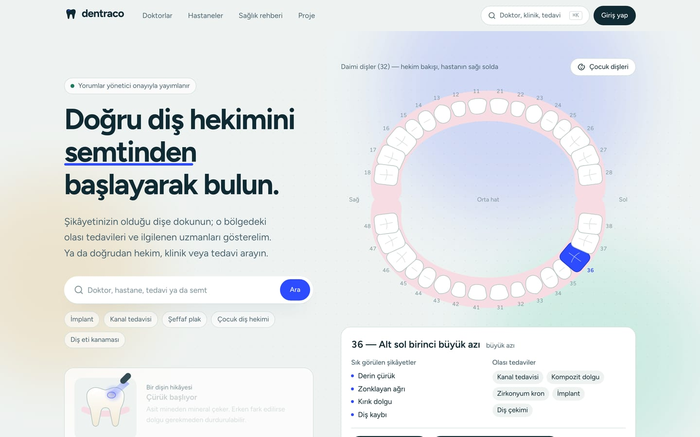
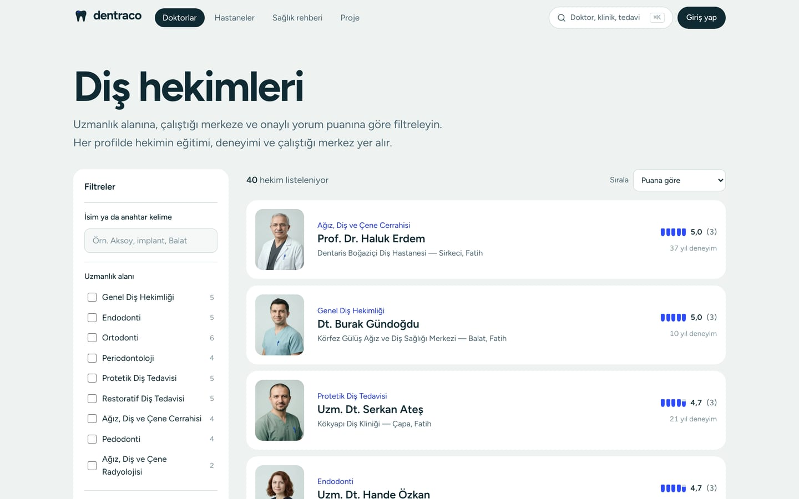
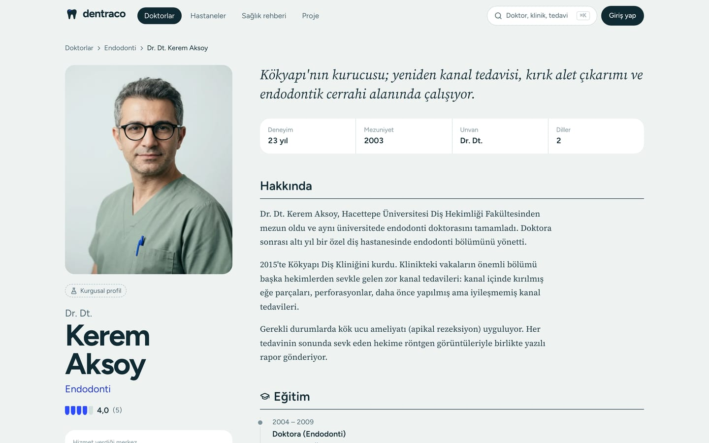
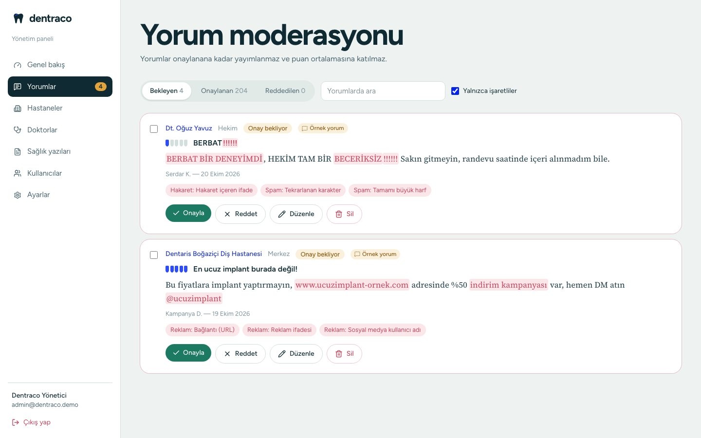

<div align="center">



<p>
  <a href="https://dentraco.vercel.app"></a>
  
  
  
</p>

<p><em>A guide where people looking for a dentist can compare clinics and dentists, read verified reviews and book.<br>
A school project prototype: every clinic, dentist, review and contact detail on the site is fictional.</em></p>

<a href="https://dentraco.vercel.app"></a>

</div>


## What it is

Dentraco helps someone with a toothache find the right specialist. Browse clinics and dentists, read each dentist's specialty and background, check reviews from verified patients and request an appointment.

| 8 | 40 | 200+ | 8 |
|:-:|:-:|:-:|:-:|
| dental centres | detailed dentist profiles | sample reviews | referenced health articles |


## Highlights

| | |
|---|---|
| **Interactive tooth map** | A 32-tooth FDI-numbered odontogram on the home page. Tap a tooth or the gum to see likely complaints, treatments and the specialists who handle them; switch to the 20 milk teeth for children. Keyboard accessible. |
| **Compare** | Clinics and dentists side by side with specialties and ratings. |
| **Profiles** | Background, specialties and verified reviews for every dentist. |
| **Health articles** | Short, referenced articles written for patients. |
| **Accounts and booking** | Sign up, save favourites and request appointments. |
| **Admin panel** | Manage clinics, dentists, reviews and requests. |
| **Ready for production** | Security headers, sitemap, Open Graph images and 64 generated visuals. |

<table>
  <tr>
    <td width="33%"></td>
    <td width="33%"></td>
    <td width="33%"></td>
  </tr>
  <tr>
    <td align="center"><code>list</code></td>
    <td align="center"><code>profile</code></td>
    <td align="center"><code>admin</code></td>
  </tr>
</table>


## Türkçe özet

**Dentraco**, diş hekimi arayanların hastaneleri ve hekimleri karşılaştırabildiği bir rehber sitesi. Hekimlerin uzmanlıklarını ve özgeçmişlerini incelemek, onaylı hasta yorumlarını okumak ve randevu talep etmek mümkün. Ana sayfadaki etkileşimli diş haritasında bir dişe dokununca olası şikâyetler, tedaviler ve ilgili uzmanlar çıkıyor. Bir okul projesi prototipi; sitedeki tüm hastane, hekim ve yorum bilgileri kurgusal.


## Development

```sh
pnpm install
pnpm dev          # http://localhost:3000
pnpm test         # vitest
pnpm typecheck
pnpm build
```

```
src/app/          routes: home, clinics, dentists, articles, account, admin
src/components/   odontogram, cards, compare, forms
src/data/         fictional clinics, dentists, reviews and articles
src/lib/          search, validation, store
supabase/         schema.sql
```

<div align="center">
<br>
<a href="https://github.com/kutluhangil"></a>
<sub>School project prototype · all clinic, dentist and review data is fictional.</sub>
</div>
