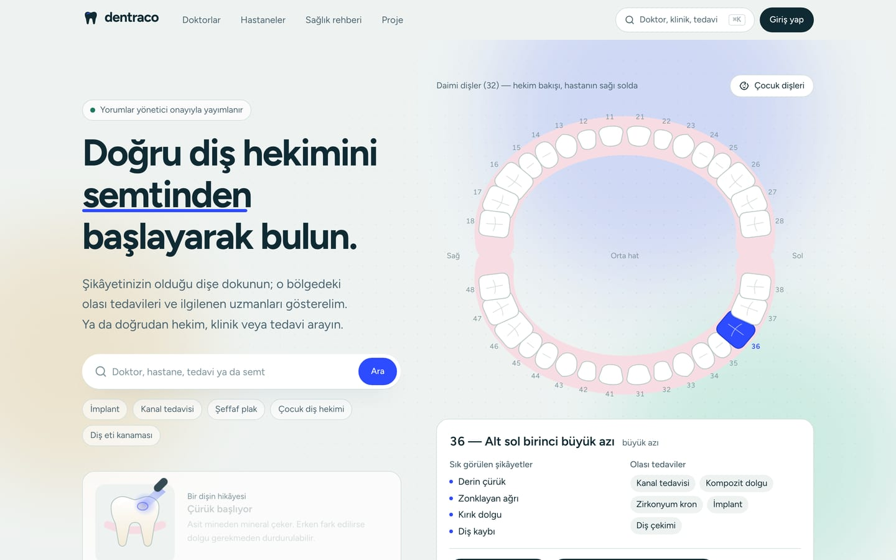
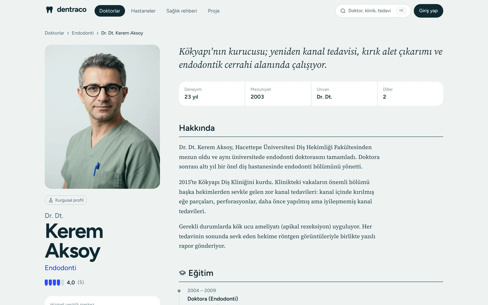
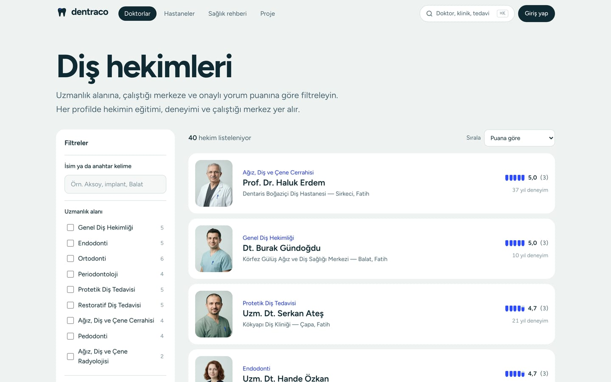
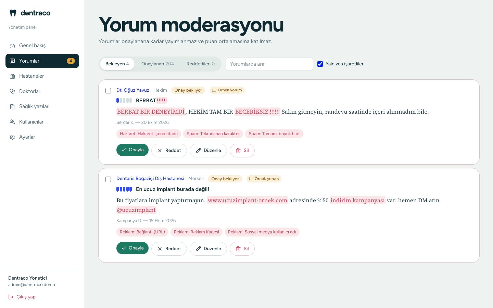
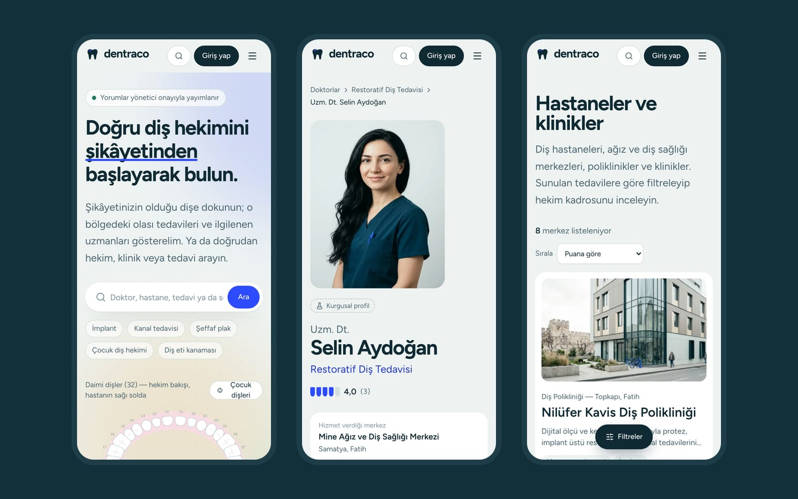
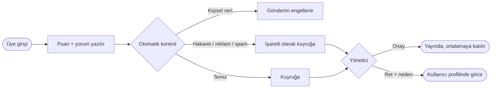
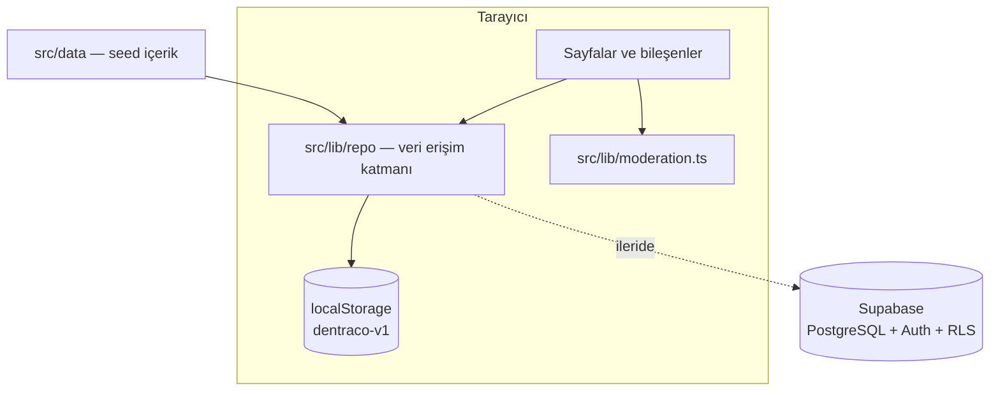

<div align="center">

<a href="https://dentraco.vercel.app">
  
</a>

<br>


<br><br>

<a href="https://dentraco.vercel.app"></a>

<br><br>


<br><br>

<sub>Okul projesi prototipi — sitedeki hastane, doktor, yorum ve iletişim bilgileri <b>kurgusaldır</b>.</sub>

</div>


## Nedir?

**Dentraco**, diş hekimi arayan kullanıcıların hastaneleri ve hekimleri karşılaştırabildiği bir rehber sitesidir. Kullanıcılar hekimlerin uzmanlık alanını ve özgeçmişini inceler, onaylı hasta yorumlarını okur, üye olup kendi deneyimini puanlar. Her yorum önce otomatik denetimden, sonra yönetici onayından geçer.

<table>
<tr>
<td width="25%" align="center"><h3>8</h3>ağız ve diş sağlığı merkezi</td>
<td width="25%" align="center"><h3>40</h3>ayrıntılı hekim özgeçmişi</td>
<td width="25%" align="center"><h3>200+</h3>örnek yorum</td>
<td width="25%" align="center"><h3>8</h3>kaynakçalı sağlık yazısı</td>
</tr>
</table>


## Öne çıkanlar

<table>
<tr>
<td width="50%" valign="top">

### 🦷 Etkileşimli diş haritası
Ana sayfada 32 dişlik, FDI numaralı bir **odontogram** var. Bir dişe ya da diş etine dokununca o bölgedeki olası şikâyetler, tedaviler ve ilgilenen uzmanlar çıkar. “Çocuk dişleri” düğmesiyle 20 süt dişine geçilir. Ok tuşlarıyla klavyeden de gezilebilir.

</td>
<td width="50%" valign="top">

### 📊 Diş rengi skalasıyla puan
Puanlar yıldız yerine diş hekimlerinin kullandığı **VITA renk skalası** sekmelerine benzeyen beş dikey çubukla gösterilir. Ortalamaya yalnızca yönetici onaylı yorumlar katılır.

</td>
</tr>
<tr>
<td width="50%" valign="top">

### 🛡️ Moderasyon
Telefon, e-posta, T.C. kimlik no ve IBAN içeren yorumlar **gönderilemez**. Hakaret, reklam ve spam otomatik **işaretlenir**. Yönetici onaylar, maskeler ya da nedeniyle reddeder.

</td>
<td width="50%" valign="top">

### ✨ Animasyonlu arayüz
Dönen kelimeli başlık, hareketli arka plan, imleci izleyen ışık, sayan rakamlar, kayan bantlar, eğilen kartlar ve kaydırdıkça dolan süreç hattı. “Hareketi azalt” ayarında hepsi kapanır.

</td>
</tr>
</table>


## Ekran görüntüleri

<p align="center"></p>

<table>
<tr>
<td width="50%"><p align="center"><sub>Hekim profili — özgeçmiş düzeni</sub></p></td>
<td width="50%"><p align="center"><sub>Uzmanlık, hastane ve puana göre filtreleme</sub></p></td>
</tr>
<tr>
<td width="50%"><p align="center"><sub>Yönetim paneli — işaretli yorumlar</sub></p></td>
<td width="50%"><p align="center"><sub>Telefon görünümü</sub></p></td>
</tr>
</table>


## Bir yorumun yolculuğu




## Sayfalar

| Sayfa | Adres | İçerik |
|---|---|---|
| Ana sayfa | `/` | Diş haritası, arama, rakamlar, tedavi bantları, öne çıkan hekimler, merkezler, rehber |
| Doktorlar | `/doktorlar` | 40 hekim; isim, uzmanlık, hastane ve puan filtresi (bağlantıyla paylaşılabilir) |
| Hekim profili | `/doktorlar/[ad-soyad]` | Eğitim, tez, deneyim, sertifika, yayın, üyelik, çalışma günleri, yorumlar; yazdırılabilir |
| Hastaneler | `/hastaneler` | 8 merkez (hepsi İstanbul Fatih'te); semt, tedavi ve puan filtresi |
| Hastane profili | `/hastaneler/[ad]` | Adres, iletişim, harita, saatler, tedaviler, hekim kadrosu, yorumlar |
| Sağlık rehberi | `/saglik-rehberi` | Çürük, kanal, diş taşı, diş eti, implant, ortodonti, hijyen, koruyucu |
| Profilim | `/profil` | Kullanıcının yorumları: onay bekliyor / yayında / reddedildi |
| Yönetim | `/admin` | Yorum kuyruğu, hastane-doktor-yazı yönetimi, kullanıcılar, demo sıfırlama |
| Proje | `/proje-hakkinda` | Kapsam, yorum ilkeleri, alan adı ve barındırma maliyeti |

Her sayfadan <kbd>Ctrl</kbd> + <kbd>K</kbd> (Mac'te <kbd>⌘</kbd> + <kbd>K</kbd>) ile arama açılır.


## Hızlı başlangıç

```bash
pnpm install
pnpm dev          # http://localhost:3000
```

<details>
<summary><b>Tüm komutlar</b></summary>

| Komut | Açıklama |
|---|---|
| `pnpm dev` | Geliştirme sunucusu |
| `pnpm build` | Production derlemesi |
| `pnpm test` | Birim testleri (moderasyon, puan, Türkçe arama, veri tutarlılığı) |
| `pnpm lint` | Kod denetimi |
| `pnpm typecheck` | Tip kontrolü |
| `pnpm prompts` | `docs/GORSEL_PROMPTLARI.md` dosyasını veriden yeniden üretir |

</details>

### Demo hesapları

| Rol | E-posta | Şifre |
|---|---|---|
| Yönetici | `admin@dentraco.demo` | `Dentraco2026!` |
| İkinci yönetici | `editor@dentraco.demo` | `Dentraco2026!` |
| Kullanıcı | `kullanici@dentraco.demo` | `Demo2026!` |

> [!NOTE]
> Demo sürümde veriler tarayıcının yerel deposunda tutulur; bir cihazdaki yorum başka cihazda görünmez. Sunumda yorumu yazma ve onaylama işini aynı tarayıcıda yapın. Yönetim → Ayarlar → **Demo verilerini sıfırla** ile başa dönülür.


## Mimari



```
src/app/(site)/        herkese açık sayfalar
src/app/admin/         yönetim paneli
src/components/        odontogram, puan sekmeleri, yorumlar, filtreler, animasyonlar
src/data/              hastaneler, doktorlar, yorumlar, makaleler (kurgusal)
src/lib/repo/          veri katmanı — Supabase'e geçişte yalnızca burası değişir
src/lib/moderation.ts  otomatik yorum denetimi
docs/                  görsel prompt'ları, maliyet analizi, veritabanı şeması
supabase/schema.sql    ileriki aşama için şema ve güvenlik kuralları
```

<details>
<summary><b>Tasarım sistemi</b></summary>

| Renk | Kod | Kullanım |
|---|---|---|
|  Porselen | `#EEF3F2` | Sayfa zemini |
|  Petrol mürekkebi | `#0F2A33` | Metin, koyu bölümler |
|  Polimerizasyon mavisi | `#2D4BFF` | Vurgu, düğmeler, puan |
|  Florür yeşili | `#8EDCC6` | Onaylandı |
|  Diş eti kırmızısı | `#C8435A` | Hata, reddedildi |

- **Yazı tipleri:** Figtree (başlık ve arayüz), Source Serif 4 (özgeçmiş ve makaleler)
- **Vurgu rengi:** Dolgu sertleştirme lambasının mavisinden esinlenildi.

</details>

<details>
<summary><b>Görseller (Gemini)</b></summary>

64 görselin tamamı için prompt, oran, çözünürlük ve dosya adı [`docs/GORSEL_PROMPTLARI.md`](docs/GORSEL_PROMPTLARI.md) dosyasındadır: 40 doktor portresi, 8 hastane dış cephesi, 8 tedavi odası ve 8 makale kapağı. Görseller eklenene kadar site otomatik yer tutucu gösterir; dosyalar `public/images/` altına konunca kod değişikliği gerekmez.

</details>

<details>
<summary><b>Maliyet</b></summary>

| Senaryo | Maliyet |
|---|---|
| Okul projesi (Vercel Hobby + `*.vercel.app`) | **0 TL** |
| `.com` alan adı | ≈ 10–11 $ / yıl |
| `.com.tr` alan adı | ≈ 450–600 TL / yıl |
| Supabase Free / Pro | 0 TL / ≈ 25 $ ay |

Fiyatlar Ekim 2026 itibarıyla yaklaşıktır. Ayrıntı ve kaynaklar: [`docs/MALIYET_VE_BARINDIRMA.md`](docs/MALIYET_VE_BARINDIRMA.md).

</details>


<div align="center">

**Dentraco** bir okul projesi kapsamında hazırlanmış bir prototiptir.<br>
<sub>Sitedeki hastane, doktor, yorum ve iletişim bilgileri kurgusaldır; gerçek kişi ve kurumlarla ilgisi yoktur.<br>Sağlık içerikleri yalnızca genel bilgilendirme amaçlıdır ve hekim muayenesinin yerini tutmaz.</sub>

<br><br>

<a href="https://dentraco.vercel.app"></a>

</div>
