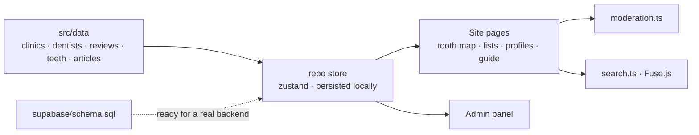

<div align="center">


<p>
  <a href="https://dentraco.vercel.app"></a>
  
  
  
</p>

<p><em>A guide to compare dental clinics and dentists in one place: start from the tooth that hurts,<br>
find the right specialty, read real-looking reviews and request an appointment.</em></p>


</div>


## The idea

People rarely know which kind of dentist they need. They know *where* it hurts. Dentraco starts there: an interactive tooth map on the home page turns "this molar aches when I chew" into likely treatments and the specialty that handles them, and from there into clinics and dentists you can compare.

> **A school project, built like a real one.** All clinics, dentists, reviews and users are fictional. The site still has what production needs: security headers and a CSP, a sitemap, Open Graph images, review moderation, an admin panel and tests.

| 8 | 40 | 200+ | 8 |
|:-:|:-:|:-:|:-:|
| dental centres | detailed dentist profiles | sample reviews | referenced health articles |


## Features

| | |
|---|---|
| **Tooth map** | A 32-tooth odontogram with FDI numbering (quadrant + position); switch to the 20 milk teeth for children. Tap a tooth or the gum for common complaints, treatments and specialists. Keyboard accessible. |
| **Clinics and dentists** | Searchable lists with fuzzy matching (Fuse.js), filters by specialty and treatment, and side-by-side comparison. |
| **Profiles** | Background, specialties, certificates and courses, clinic, ratings and reviews for every dentist. |
| **Reviews** | Ratings with a moderation step that screens for insults before a review is shown. |
| **Health guide** | Short, referenced articles written for patients, rendered from Markdown. |
| **Accounts** | Sign up, sign in, a profile with favourites and appointment requests. |
| **Admin panel** | Clinics, dentists, articles, reviews, users and settings. |
| **About the project** | Scope, technical setup, review principles and a domain / hosting cost analysis. |
| **Production touches** | Security headers with a CSP in production, sitemap, OG images and 64 generated visuals. |

<table>
  <tr>
    <td width="33%"></td>
    <td width="33%"></td>
    <td width="33%"></td>
  </tr>
  <tr>
    <td align="center">Dentists</td><td align="center">Profile</td><td align="center">Admin</td>
  </tr>
</table>


## How it fits together



Data ships with the app and edits are kept in the browser, which suits a prototype that has to demo without a server. `supabase/schema.sql` describes the same model for a real database.

| Route | Page |
|---|---|
| `/` | Home with the tooth map |
| `/hastaneler` · `/hastaneler/[slug]` | Clinics |
| `/doktorlar` · `/doktorlar/[slug]` | Dentists |
| `/saglik-rehberi` · `/saglik-rehberi/[slug]` | Health guide |
| `/giris` · `/kayit` · `/profil` | Account |
| `/proje-hakkinda` | About the project |
| `/admin/*` | Clinics, dentists, articles, reviews, users, settings |


## Türkçe özet

**Dentraco**, diş klinikleri ve diş hekimlerini tek yerde karşılaştıran bir rehber; bir okul projesi, tüm veriler kurgusal. Ana sayfadaki etkileşimli diş haritası (FDI numaralı 32 kalıcı, 20 süt dişi) ağrıyan dişten olası şikâyetlere, tedavilere ve ilgili uzmanlığa götürüyor. Klinik ve hekim listeleri, ayrıntılı profiller, moderasyonlu yorumlar, kaynaklı sağlık yazıları, randevu talebi ve yönetici paneli var. Güvenlik başlıkları, site haritası ve OG görselleriyle canlıya hazır.


## Development

```sh
pnpm install
pnpm dev             # http://localhost:3000
pnpm test            # vitest: data, moderation, rating and search, URLs
pnpm typecheck
pnpm build
```

No environment variables are needed. `NOTE.md` explains the project for anyone presenting it.

```
src/app/(site)/   public pages (Turkish routes)
src/app/admin/    the admin panel
src/data/         fictional clinics, dentists, reviews, teeth, specialties, articles
src/lib/          repo store, search, rating, moderation, slugs, URLs
supabase/         schema.sql for a future backend
```

<div align="center">
<br>
<a href="https://github.com/kutluhangil"></a>
<sub>MIT licensed · a school project with fictional data, not medical advice · the clinic and dentist in the banner are fictional.</sub>
</div>
